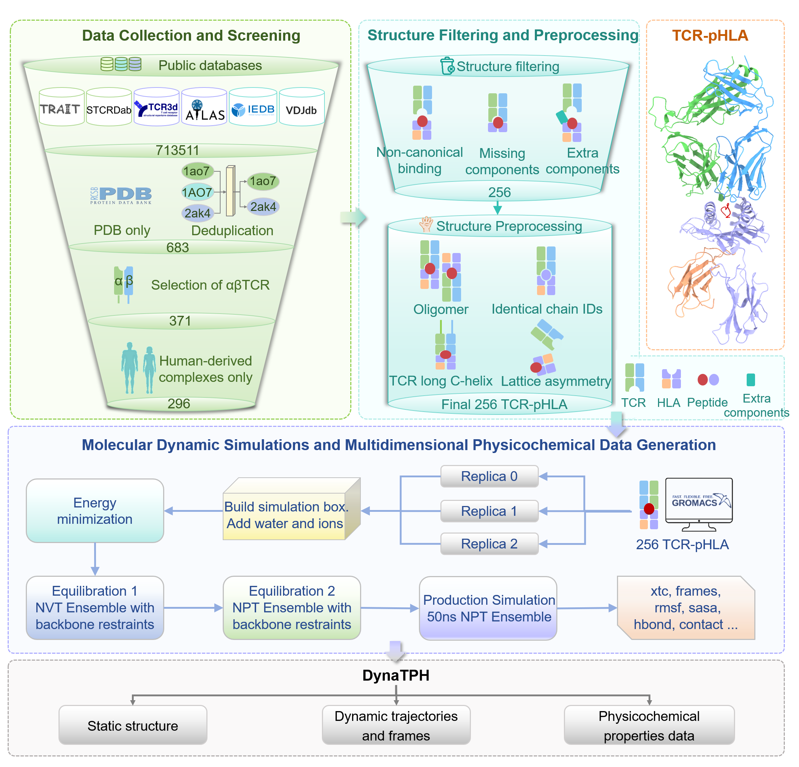
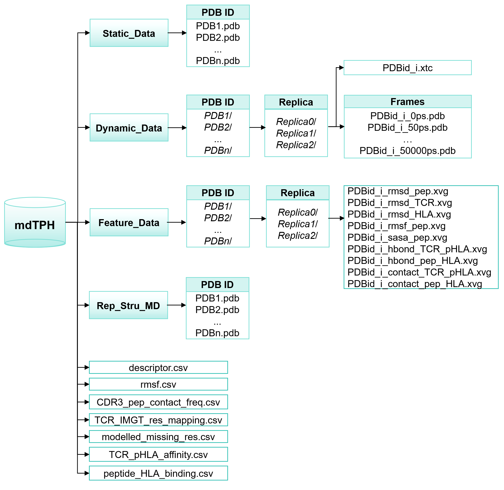

# DynaTPH Dataset Repository

Welcome to the DynaTPH dataset repository! 

DynaTPH is a systematically curated structural and biophysical dataset of human T cell receptor-peptide-human leukocyte antigen (TCR-pHLA) complexes, integrating **static experimental structures, molecular dynamics (MD) trajectories and corresponding structural frames, multidimensional physicochemical properties, and experimental binding annotations**. The dataset covers both **HLA class I and class II** complexes and is designed to provide a comprehensive representation of the structural and dynamic landscape of TCR-pHLA recognition. DynaTPH comprises 256 representative TCR-pHLA complexes, each subjected to three independent 50 ns all-atom MD simulations, resulting in 38.4 μs of cumulative simulation time. The dataset includes curated starting structures, dynamic trajectories, trajectory-derived structural frames, and multidimensional physicochemical descriptors, including hydrogen bonds, intermolecular contacts, solvent-accessible surface area, and conformational flexibility.

**This GitHub repository contains a lightweight version of the DynaTPH dataset and the dataset-specific scripts used for data collection and screening.**

---

## Useful Links

**Zenodo**：The complete DynaTPH dataset is available on Zenodo **(https://doi.org/10.5281/zenodo.21971877)** 
（The Zenodo repository is currently restricted for peer review.）

The complete `Dynamic Data` are archived on Zenodo because of their large storage requirements.

---

## Dataset Workflow
The overall workflow used to construct the DynaTPH dataset is illustrated below.

<p align="center">
  
</p>

The scripts provided in this repository correspond to the **Data Collection and Screening** stage of the workflow. Database-specific scripts were used to screen TCR-pHLA structures collected from multiple structural databases, followed by `combine.ipynb` for combining screened records and removing duplicate structures. Detailed information on script inputs, outputs, and usage is provided in `scripts/README.md`.

---


## Dataset Overview

| Item                    | Description        |
| ----------------------- | ------------------ |
| Dataset                 | DynaTPH            |
| Molecular system        | TCR-pHLA complexes |
| Number of complexes     | 256                |
| HLA class I complexes   | 205                |
| HLA class II complexes  | 51                 |
| MD replicas per complex | 3                  |
| Total MD replicas       | 768                |
| Production simulation   | 50 ns per replica  |
| Total simulation time   | 38.4 μs            |
| Trajectory format       | XTC                |
| Structure format        | PDB                |
| Frame interval          | 50 ps              |
| Frames per replica      | 1,001              |

---

## Dataset Organization

The DynaTPH dataset is organized into four top-level directories — **Static Data**, **Dynamic Data**, **Feature Data**, and **Rep_Stru_MD** — accompanied by one system-level descriptor file (`descriptor.csv`), three residue-level descriptor files (`rmsf.csv`, `CDR3_pep_contact_freq.csv`, and `TCR_IMGT_res_mapping.csv`), a missing-residue modelling record (`modelled_missing_res.csv`), and two experimental binding data files (`TCR_pHLA_affinity.csv` and `peptide_HLA_binding.csv`).

The overall organization of the dataset is illustrated below.

<p align="center">
  
</p>

| Component | Content |
| --------- | ------- |
| `Static Data/` | Curated TCR-pHLA starting structures (PDB) |
| `Dynamic Data/` | MD trajectories (XTC) and extracted frames (PDB) per replica |
| `Feature Data/` | Trajectory-derived physicochemical features per replica |
| `Rep_Stru_MD/` | One representative structure per complex (PDB) |
| `descriptor.csv` | System-level structural, sequence, physicochemical, and dynamic descriptors |
| `rmsf.csv` | Residue-level RMSF of peptide residues |
| `CDR3_pep_contact_freq.csv` | Residue-pair contact frequencies between CDR3β and peptide |
| `TCR_IMGT_res_mapping.csv` | IMGT49 residue mapping for TCR α/β chains |
| `modelled_missing_res.csv` | Record of missing residues modelled before MD |
| `TCR_pHLA_affinity.csv` | Experimental TCR-pHLA binding affinity (ATLAS) |
| `peptide_HLA_binding.csv` | Experimental peptide-HLA binding measurements (IEDB) |

**This GitHub repository contains the lightweight components of DynaTPH and is organized as follows:**

```text
DynaTPH/
├── Static Data/
├── Feature Data/
├── Rep_Stru_MD/
├── scripts/
├── descriptor.csv
├── rmsf.csv
├── CDR3_pep_contact_freq.csv
├── TCR_IMGT_res_mapping.csv
├── modelled_missing_res.csv
├── TCR_pHLA_affinity.csv
├── peptide_HLA_binding.csv
└── README.md
```

> `Dynamic Data/` is omitted from this repository due to file size; see Zenodo for the full data.

---

## Data Description

### 1. Static Data

The `Static Data` directory contains curated TCR-pHLA complex structures used as the initial configurations for molecular dynamics simulations.

Each structure is provided in PDB format and named according to its PDB ID.

```text
Static Data/
├── 1BD2.pdb
├── XXXX.pdb
└── ...
```

A total of **256 TCR-pHLA complexes** are included.

The structures were curated and preprocessed before MD simulations to obtain standardized starting configurations. Structure preprocessing information is recorded in `descriptor.csv`.

---

### 2. Dynamic Data

The `Dynamic Data` directory contains the molecular dynamics trajectories and corresponding structural frames generated for the 256 TCR-pHLA complexes.

Because of the large size of the trajectory and frame files, **Dynamic Data is not included in this GitHub repository**.

Instead, the complete `Dynamic Data` directory is available as part of the full DynaTPH dataset archived on **Zenodo (https://doi.org/10.5281/zenodo.21971877)**.（The dataset is currently restricted for peer review and will be made publicly available soon.）

Each complex folder contains three replicate simulations (`Replica0`, `Replica1`, and `Replica2`), corresponding to three independent MD runs. Within each Replica folder:

* the integrated 50 ns trajectory is provided in XTC format;
* a `Frames/` directory contains structures extracted at 50 ps intervals, yielding **1,001 frames per replica**;
* the first frame (0 ps) corresponds to the initial TCR-pHLA complex structure;
* the index `i` in file names corresponds to `Replica0`, `Replica1`, and `Replica2` (`i = 0, 1, 2`);
* all trajectories and frames contain only the TCR-pHLA complex, with solvent molecules and ions removed.

---

### 3. Feature Data

The `Feature Data` directory contains multidimensional physicochemical and structural descriptors derived from the molecular dynamics trajectories.

The directory is organized by PDB ID and simulation replica:

```text
Feature Data/
└── PDB_ID/
    ├── Replica0/
    ├── Replica1/
    └── Replica2/
```

The feature data include trajectory-derived properties such as:

* RMSD of the peptide, TCR, and HLA
* peptide RMSF
* solvent-accessible surface area (SASA)
* hydrogen-bond profiles
* contact profiles

Interface-specific descriptors are provided for both:

* `TCR_pHLA`: TCR-pHLA interface
* `pep_HLA`: peptide-HLA interface

These features provide complementary information on structural stability, conformational fluctuations, intermolecular hydrogen bonding, and interfacial contacts during the MD simulations.

---

### 4. `descriptor.csv`

`descriptor.csv` is the **system-level descriptor file** of DynaTPH.

Each row corresponds to one TCR-pHLA complex and is indexed by PDB ID.

The file contains structural, sequence, physicochemical, and dynamic information, including:

#### Structural and sequence information

* PDB ID
* HLA class
* HLA allele
* HLA α-chain sequence
* HLA β-chain sequence
* peptide sequence
* peptide length
* TCR α-chain sequence
* TCR β-chain sequence
* TRAV, TRAJ, TRBV, and TRBJ gene annotations
* CDR3α and CDR3β sequences

#### Physicochemical and interface properties

* peptide SASA
* peptide-HLA hydrogen-bond counts
* peptide-HLA contact counts
* TCR-pHLA hydrogen-bond counts
* TCR-pHLA contact counts

Dynamic quantities were calculated from the three independent MD trajectories using a consistent analysis workflow and summarized at the system level.

Information describing structural modifications and preprocessing applied before MD simulations is also recorded in this file.

---

### 5. `rmsf.csv`

`rmsf.csv` provides **residue-level RMSF information for peptide residues** in individual TCR-pHLA complexes.

Each RMSF value is associated with a specific peptide residue and PDB ID.

Because peptide sequences have variable lengths, residue-level RMSF values are provided separately rather than being incorporated into the fixed-column, system-level `descriptor.csv`.

---

### 6. Rep_Stru_MD

The `Rep_Stru_MD` directory provides **one representative structure for each of the 256 TCR-pHLA complexes**.

Each structure is extracted from the **final frame of Replica0** after equilibration and is provided in PDB format:

```text
Rep_Stru_MD/
├── 1BD2.pdb
├── XXXX.pdb
└── ...
```

This directory offers a convenient snapshot for structural inspection and reuse without requiring users to access the full trajectories.

---

### 7. `CDR3_pep_contact_freq.csv`

`CDR3_pep_contact_freq.csv` is a **residue-level contact frequency file** describing dynamic interactions between the TCR CDR3β loop and the peptide.

It reports residue-pair contact frequencies between **CDR3β and peptide residues** during the MD simulation equilibrium phase (**40–50 ns**), characterizing their dynamic interfacial interactions.

---

### 8. `TCR_IMGT_res_mapping.csv`

`TCR_IMGT_res_mapping.csv` provides **IMGT49 residue mapping** for residues in the TCR α and β chains.

For each TCR residue, the file records its IMGT49 position, region annotation, and mapping status. The mapping is generated by sequence annotation using **ANARCI** with the IMGT49 numbering scheme.

---

### 9. `modelled_missing_res.csv`

`modelled_missing_res.csv` records **missing residues that were identified by sequence alignment and modelled using MODELLER** before MD simulations.

Each row includes:

* PDB ID
* chain ID
* chain type (TCR or HLA)
* residue number
* residue name

This file allows users to trace which residues were added to each structure during system preparation.

---

### 10. Experimental binding data

Two CSV files provide complementary **experimental binding annotations** for DynaTPH complexes.

#### `TCR_pHLA_affinity.csv`

Contains TCR-pHLA binding affinity data from **ATLAS** for **207 DynaTPH complexes**.

#### `peptide_HLA_binding.csv`

Contains peptide-HLA binding measurements from **IEDB** for **100 DynaTPH complexes**.

Both files are matched to DynaTPH based on **peptide-HLA combinations**. The corresponding PDB IDs and the number of associated structures are recorded for each combination. Source and study identifiers, measurement types, and experimental methods and conditions are retained where available. **Multiple measurements are preserved** when reported by the source databases.

---

## Citation

If you use DynaTPH in your research, please cite the associated publication and the archived dataset.

Citation information for the associated publication will be provided here upon publication.

---

## Contact

For any questions regarding the dataset, please contact the corresponding author.

Lei Fu: [leifu@szu.edu.cn](mailto:leifu@szu.edu.cn)

Institute of Medical Artificial Intelligence, South China Hospital, Medical School, Shenzhen University, Shenzhen, 518116, P. R. China
